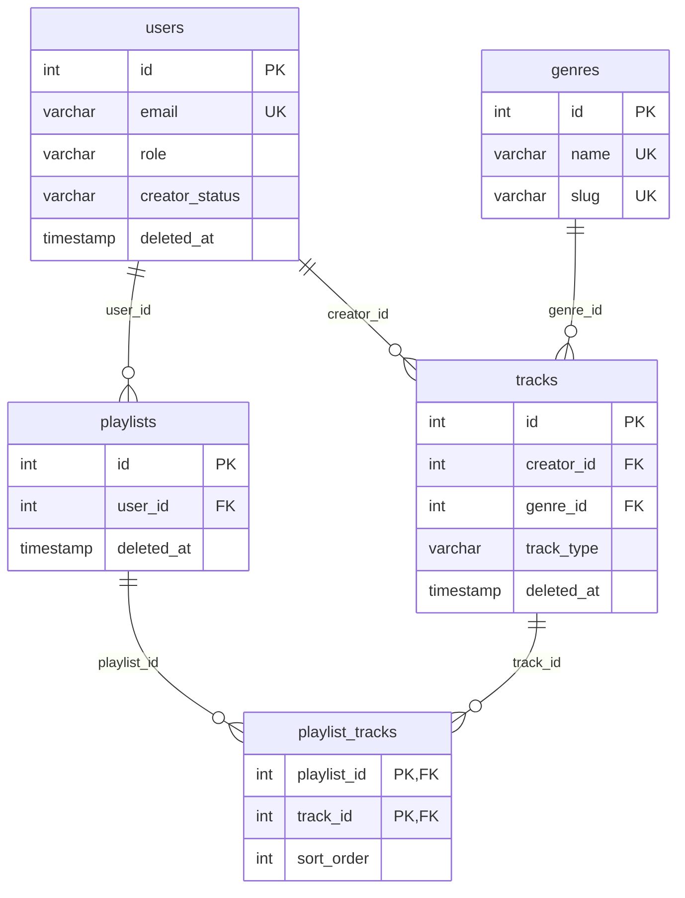

# Mô hình dữ liệu: DDL hiện có và đích đã chọn

Phạm vi quan sát: [schema.sql](../../database/schema.sql), chưa thực thi. Bảng này ghi **đúng DDL hiện có**, không phê duyệt schema đích. Database đích đã chọn PostgreSQL 18 tại [DEC-013](../decisions/open-decisions.md#dec-013); thay đổi ràng buộc ở [DEC-022](../decisions/open-decisions.md#dec-022).

## ERD của DDL hiện có

Sơ đồ thể hiện khóa và quan hệ; các bảng bên dưới là từ điển đầy đủ. Một track có đúng một creator và một genre theo FK NOT NULL; bảng liên kết biểu diễn quan hệ nhiều–nhiều playlist/track.

## USERS

| Cột | Kiểu SQL | NULL | Default/ràng buộc | Ý nghĩa |
| --- | --- | --- | --- | --- |
| id | SERIAL | Không | PK | Định danh tự tăng |
| username | VARCHAR(50) | Không | Không default | Tên hiển thị; không UNIQUE |
| email | VARCHAR(100) | Không | UNIQUE | Email; DDL chưa chuẩn hóa chữ hoa/thường |
| password_hash | VARCHAR(255) | Không | Không default | Chuỗi hash; không có CHECK thuật toán |
| role | VARCHAR(20) | Không | `'listener'`; CHECK listener/creator/admin | Vai trò |
| creator_status | VARCHAR(20) | Không | `'none'`; CHECK none/pending/approved/rejected | Trạng thái hồ sơ |
| channel_name | VARCHAR(100) | Có | NULL | Tên kênh/nghệ danh |
| bio | TEXT | Có | NULL | Giới thiệu kênh |
| avatar_url | VARCHAR(255) | Có | `'/uploads/images/default-avatar.png'` | Tham chiếu ảnh |
| created_at | TIMESTAMP | Không | CURRENT_TIMESTAMP | Thời điểm tạo tài khoản |
| deleted_at | TIMESTAMP | Có | NULL | Thời điểm khóa/xóa mềm |

Không có ngày nộp hồ sơ, lý do từ chối, người review hoặc lịch sử review. Những dữ liệu này thuộc [DEC-007](../decisions/open-decisions.md#dec-007). SQL cũng chưa ràng buộc quan hệ role–creator_status.

## GENRES

| Cột | Kiểu SQL | NULL | Default/ràng buộc | Ý nghĩa |
| --- | --- | --- | --- | --- |
| id | SERIAL | Không | PK | Mã thể loại |
| name | VARCHAR(50) | Không | UNIQUE | Tên thể loại |
| slug | VARCHAR(50) | Không | UNIQUE | Khóa đường dẫn thân thiện |
| description | VARCHAR(255) | Có | NULL | Mô tả thể loại |

DDL chưa có CHECK format slug hoặc phân loại genre riêng cho music/podcast.

## TRACKS

| Cột | Kiểu SQL | NULL | Default/ràng buộc | Ý nghĩa |
| --- | --- | --- | --- | --- |
| id | SERIAL | Không | PK | Mã tác phẩm |
| title | VARCHAR(150) | Không | Không default | Tiêu đề |
| artist_name | VARCHAR(100) | Không | Không default | Nghệ sĩ/host, khác người upload |
| audio_file_path | VARCHAR(255) | Không | Không default | Tham chiếu audio |
| cover_image_path | VARCHAR(255) | Có | `'/uploads/images/default-cover.png'` | Tham chiếu cover |
| duration | INT | Không | 0 | Số giây; chưa CHECK không âm |
| track_type | VARCHAR(10) | Không | `'music'`; CHECK music/podcast | Loại tác phẩm |
| play_count | INT | Không | 0 | Lượt nghe; chưa CHECK không âm |
| genre_id | INT | Không | FK genres.id, ON DELETE RESTRICT | Thể loại |
| creator_id | INT | Không | FK users.id, ON DELETE CASCADE | Chủ sở hữu upload |
| created_at | TIMESTAMP | Không | CURRENT_TIMESTAMP | Thời điểm tạo |
| deleted_at | TIMESTAMP | Có | NULL | Thời điểm gỡ |
| lyrics | TEXT | Có | NULL | Lời bài hát |
| description | TEXT | Có | NULL | Mô tả/show notes |

Không có constraint đảm bảo creator đã duyệt, phân biệt lyrics theo type hoặc file tồn tại. Quy tắc duration/file đích đã chọn tại DEC-009/DEC-011; DDL quan sát chưa thực thi các quy tắc đó. Chính sách text theo DEC-021 đã chốt ở BR-006; nhận diện HTML/đếm ký tự còn DEC-017. `artist_name` là metadata biểu diễn, không thay thế `creator_id` khi kiểm tra sở hữu.

## PLAYLISTS

| Cột | Kiểu SQL | NULL | Default/ràng buộc | Ý nghĩa |
| --- | --- | --- | --- | --- |
| id | SERIAL | Không | PK | Mã playlist |
| title | VARCHAR(100) | Không | Không default | Tên playlist |
| description | TEXT | Có | NULL | Mô tả |
| cover_image_path | VARCHAR(255) | Có | `'/uploads/images/default-playlist.png'` | Cover |
| user_id | INT | Không | FK users.id, ON DELETE CASCADE | Người sở hữu |
| created_at | TIMESTAMP | Không | CURRENT_TIMESTAMP | Thời điểm tạo |
| deleted_at | TIMESTAMP | Có | NULL | Thời điểm xóa mềm |

Không có cột public/private hoặc unique title theo user. Không thêm các khả năng đó chỉ vì có thể mở rộng schema.

## PLAYLIST_TRACKS

| Cột | Kiểu SQL | NULL | Default/ràng buộc | Ý nghĩa |
| --- | --- | --- | --- | --- |
| playlist_id | INT | Không | PK ghép; FK playlists.id, ON DELETE CASCADE | Playlist chứa track |
| track_id | INT | Không | PK ghép; FK tracks.id, ON DELETE CASCADE | Track được thêm |
| sort_order | INT | Không | 1 | Vị trí; chưa UNIQUE hoặc CHECK |
| added_at | TIMESTAMP | Không | CURRENT_TIMESTAMP | Thời điểm thêm |

PK `(playlist_id, track_id)` ngăn trùng thành viên, không đảm bảo thứ tự duy nhất. Default 1 là giá trị SQL đã quan sát; nghiệp vụ đích cũng bắt đầu từ 1, nhưng constraint/transaction đích chưa triển khai (DEC-022). Reorder và đồng thời thuộc [DEC-019](../decisions/open-decisions.md#dec-019).

## Index khai báo tường minh

| Tên | Bảng/cột |
| --- | --- |
| idx_users_email | users(email) |
| idx_users_creator_status | users(creator_status) |
| idx_tracks_genre_id | tracks(genre_id) |
| idx_tracks_creator_id | tracks(creator_id) |
| idx_tracks_play_count | tracks(play_count DESC) |
| idx_tracks_type | tracks(track_type) |
| idx_tracks_deleted_at | tracks(deleted_at) |
| idx_playlists_user_id | playlists(user_id) |
| idx_playlist_tracks_track_id | playlist_tracks(track_id) |

PK/UNIQUE còn dẫn tới index do database tạo khi DDL chạy. `users.email` đã UNIQUE và có index tường minh riêng; docs không tự loại index. Chưa có EXPLAIN hay benchmark chứng minh hiệu quả tìm kiếm/filter.

## Giới hạn và tác động thao tác

- Schema bắt đầu bằng DROP TABLE IF EXISTS … CASCADE cho cả năm bảng. Đây là script reset cấu trúc, không phải migration giữ dữ liệu.
- FK RESTRICT ngăn xóa vật lý genre còn track; CASCADE lan khi xóa vật lý user/playlist/track, không lan khi UPDATE deleted_at.
- TIMESTAMP trong SQL hiện có không chỉ định timezone. Đích dùng TIMESTAMPTZ và API ISO 8601 UTC. Migration đầu tiên áp dụng trên DB trống theo DEC-022.
- DEFAULT không ngăn NULL trên cột nullable; không suy ra mọi cột ảnh luôn có chuỗi đường dẫn.
- Không có bảng session, OTP, listening history, creator application hoặc audit. Yêu cầu liên quan không được coi đã đáp ứng chỉ bằng năm bảng hiện tại.
- Chuẩn hóa và ràng buộc nghiệp vụ đích chưa được nghiệm thu chỉ từ nhãn “3NF”; không tự tạo migration sửa các khoảng trống.

Hướng dẫn thao tác dữ liệu ở [local setup](../development/local-setup.md); bộ kiểm thử cấu trúc và seed ở [TC-19](../testing/acceptance.md#tc-19).

## Mô hình đích — chưa triển khai

Nguồn [xác nhận đơn giản](../decisions/open-decisions.md#evidence-simple-2026-11-17), [ADR-0005](../decisions/adr-0005-simple-backend-contracts.md). Năm bảng/40 cột/chín index phía trên là DDL hiện có/không đổi/chưa chạy. Đích giữ năm bảng và thêm bốn bảng; chưa có CREATE TABLE hoặc migration đích.

| Thành phần | CONFIRMED | Chi tiết còn OPEN |
| --- | --- | --- |
| users | Email trim/lowercase UNIQUE, email_verified_at NULL lúc đăng ký, password scrypt, users.role nguồn quyền | FK/default/null, định dạng hash |
| otp_challenges | Purpose đăng ký/reset, digest HMAC/secret riêng, thời hạn/số thử/đã dùng/PostgreSQL | Cột/kiểu/FK/UNIQUE/index, counters/IP limit, timeout/lỗi/giao dịch resend-verify |
| auth_sessions | UUID/user/thời hạn/thu hồi/CSRF; 24 giờ tuyệt đối/nhiều phiên/bền restart | Cột/kiểu/FK/index/null/default, key/CSRF lifecycle/lock order |
| creator_applications | Tên kênh/bio/lĩnh vực/ngày nộp/trạng thái/người-ngày duyệt/lý do, một pending/user/lịch sử | Cột/kiểu/FK/index, creatorStatus suy ra hồ sơ/mapping nhiều lần nộp/kênh duyệt |
| listen_cooldowns | Track/người nghe/mốc gần nhất, trượt 30 phút/giữ bảy ngày rồi dọn | Cột/kiểu/khóa user hoặc Guest UUID/FK/UNIQUE/index/cạnh tranh/scheduler |
| tracks | Duration ffprobe ceiling INT >0/play_count >=0, UUID/storage path nội bộ/audioUrl; search_text cùng metadata | Cột/default/index/migration; pg_trgm chỉ xem xét sau đo |
| playlist_tracks | sort_order >0/từ 1/UNIQUE thứ tự lúc commit/khóa playlist; reorder ID hiển thị/ẩn cuối | DDL deferred/lock order với trạng thái track-user/read mapping |
| Chung | TIMESTAMPTZ/UTC/ảnh mặc định/soft delete giữ hàng-file-liên kết, migration có phiên bản khởi tạo DB mới, seed riêng | PK/FK/index/default/null, chưa có SQL đích |

Schema đích suy ra `creatorStatus` từ hồ sơ. Cột `users.creator_status` thuộc DDL cũ và được mô tả ở từ điển. API-25 dùng application ID, ngày nộp và lịch sử xét duyệt lấy từ hồ sơ.

Khóa hàng user khi login/khóa/đổi mật khẩu, hàng hồ sơ khi review; reset thay hash/thu hồi phiên nguyên tử. Cooldown/tăng play_count cùng transaction. Ban chỉ tạm ẩn, không UPDATE tracks.deleted_at; unban không hồi sinh phiên/track gỡ. Lock order/race cần cụ thể ở DEC-022, chưa là code hoàn chỉnh.

### Media và recovery state

[File lifecycle](security-and-media.md#file-lifecycle): publish trước COMMIT/đối chiếu kết quả chưa rõ/dọn startup-30 phút->24 giờ/bỏ active-tham chiếu kể cả soft delete/cover cũ sau commit giữ nguyên. Active/commit outcome/danh sách dọn/chống scan-delete race còn DEC-014/022; chưa chọn queue/journal. Chín bảng nghiệp vụ không đóng câu hỏi dữ liệu kỹ thuật bổ sung.

### Migration khởi tạo

Theo [DEC-022 ngày 18/11/2026](../decisions/open-decisions.md#evidence-initial-migration-2026-11-18), migration có phiên bản dùng `node-pg-migrate` để khởi tạo schema đích trên PostgreSQL 18 trống. DDL/seed reset cũ nằm ngoài luồng khởi tạo. Seed demo được chuẩn bị riêng với hash scrypt và kiểm chứng đăng nhập sau xác minh email theo DEC-020. Chưa có file migration.
