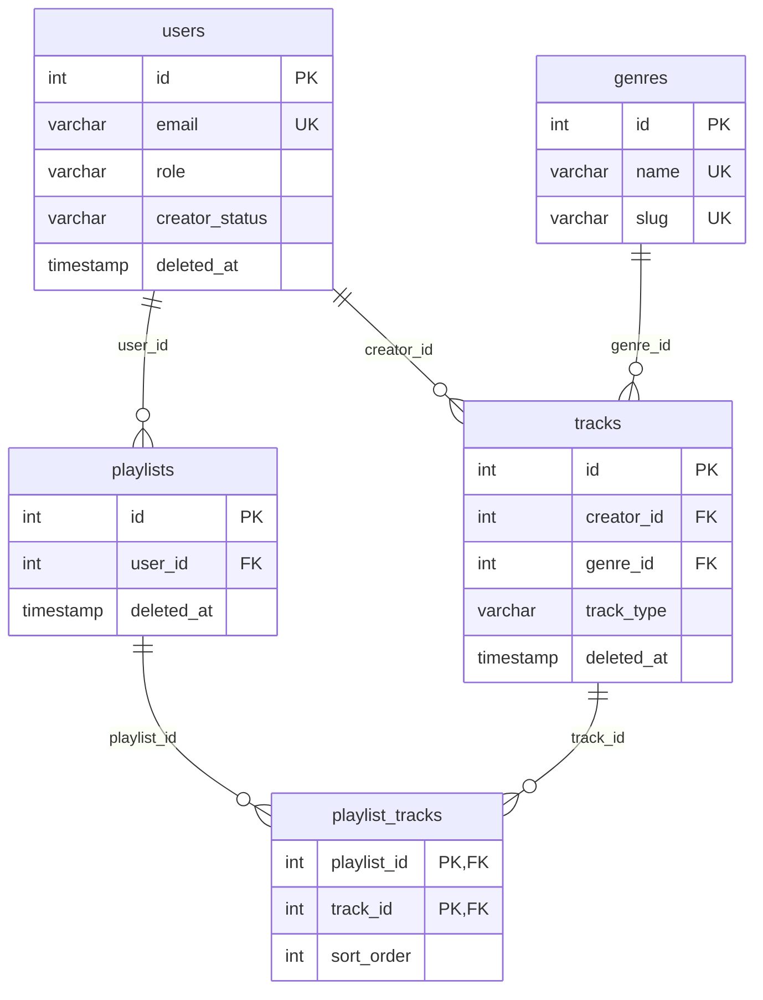

# Mô hình dữ liệu: DDL hiện có và đích đã chọn

Phạm vi quan sát: [schema.sql](../../database/schema.sql), chưa thực thi. Bảng này ghi **đúng DDL hiện có**, không phê duyệt schema đích. Database đích đã chọn PostgreSQL 18 tại [DEC-013](../decisions/open-decisions.md#dec-013); thay đổi ràng buộc ở [DEC-022](../decisions/open-decisions.md#dec-022).

## ERD của DDL hiện có

Sơ đồ thể hiện khóa và quan hệ; các bảng bên dưới là từ điển đầy đủ. Một track có đúng một creator và một genre theo FK NOT NULL; bảng liên kết biểu diễn quan hệ nhiều–nhiều playlist/track.

## USERS

| Cột | Kiểu SQL | NULL | Default/ràng buộc | Ý nghĩa |
| --- | --- | --- | --- | --- |
| id | SERIAL | Không | PK | Định danh tự tăng |
| username | VARCHAR(50) | Không | Không default | Tên hiển thị; không UNIQUE |
| email | VARCHAR(100) | Không | UNIQUE | Email; DDL chưa chuẩn hóa chữ hoa/thường |
| password_hash | VARCHAR(255) | Không | Không default | Chuỗi hash; không có CHECK thuật toán |
| role | VARCHAR(20) | Không | `'listener'`; CHECK listener/creator/admin | Vai trò |
| creator_status | VARCHAR(20) | Không | `'none'`; CHECK none/pending/approved/rejected | Trạng thái hồ sơ |
| channel_name | VARCHAR(100) | Có | NULL | Tên kênh/nghệ danh |
| bio | TEXT | Có | NULL | Giới thiệu kênh |
| avatar_url | VARCHAR(255) | Có | `'/uploads/images/default-avatar.png'` | Tham chiếu ảnh |
| created_at | TIMESTAMP | Không | CURRENT_TIMESTAMP | Thời điểm tạo tài khoản |
| deleted_at | TIMESTAMP | Có | NULL | Thời điểm khóa/xóa mềm |

Không có ngày nộp hồ sơ, lý do từ chối, người review hoặc lịch sử review. Những dữ liệu này thuộc [DEC-007](../decisions/open-decisions.md#dec-007). SQL cũng chưa ràng buộc quan hệ role–creator_status.

## GENRES

| Cột | Kiểu SQL | NULL | Default/ràng buộc | Ý nghĩa |
| --- | --- | --- | --- | --- |
| id | SERIAL | Không | PK | Mã thể loại |
| name | VARCHAR(50) | Không | UNIQUE | Tên thể loại |
| slug | VARCHAR(50) | Không | UNIQUE | Khóa đường dẫn thân thiện |
| description | VARCHAR(255) | Có | NULL | Mô tả thể loại |

DDL chưa có CHECK format slug hoặc phân loại genre riêng cho music/podcast.

## TRACKS

| Cột | Kiểu SQL | NULL | Default/ràng buộc | Ý nghĩa |
| --- | --- | --- | --- | --- |
| id | SERIAL | Không | PK | Mã tác phẩm |
| title | VARCHAR(150) | Không | Không default | Tiêu đề |
| artist_name | VARCHAR(100) | Không | Không default | Nghệ sĩ/host, khác người upload |
| audio_file_path | VARCHAR(255) | Không | Không default | Tham chiếu audio |
| cover_image_path | VARCHAR(255) | Có | `'/uploads/images/default-cover.png'` | Tham chiếu cover |
| duration | INT | Không | 0 | Số giây; chưa CHECK không âm |
| track_type | VARCHAR(10) | Không | `'music'`; CHECK music/podcast | Loại tác phẩm |
| play_count | INT | Không | 0 | Lượt nghe; chưa CHECK không âm |
| genre_id | INT | Không | FK genres.id, ON DELETE RESTRICT | Thể loại |
| creator_id | INT | Không | FK users.id, ON DELETE CASCADE | Chủ sở hữu upload |
| created_at | TIMESTAMP | Không | CURRENT_TIMESTAMP | Thời điểm tạo |
| deleted_at | TIMESTAMP | Có | NULL | Thời điểm gỡ |
| lyrics | TEXT | Có | NULL | Lời bài hát |
| description | TEXT | Có | NULL | Mô tả/show notes |

Không có constraint đảm bảo creator đã duyệt, phân biệt lyrics theo type hoặc file tồn tại. Quy tắc duration/file đích đã chọn tại DEC-009/DEC-011; DDL quan sát chưa thực thi các quy tắc đó. Chính sách text theo DEC-021 đã chốt ở BR-006; nhận diện HTML/đếm ký tự còn DEC-017. `artist_name` là metadata biểu diễn, không thay thế `creator_id` khi kiểm tra sở hữu.

## PLAYLISTS

| Cột | Kiểu SQL | NULL | Default/ràng buộc | Ý nghĩa |
| --- | --- | --- | --- | --- |
| id | SERIAL | Không | PK | Mã playlist |
| title | VARCHAR(100) | Không | Không default | Tên playlist |
| description | TEXT | Có | NULL | Mô tả |
| cover_image_path | VARCHAR(255) | Có | `'/uploads/images/default-playlist.png'` | Cover |
| user_id | INT | Không | FK users.id, ON DELETE CASCADE | Người sở hữu |
| created_at | TIMESTAMP | Không | CURRENT_TIMESTAMP | Thời điểm tạo |
| deleted_at | TIMESTAMP | Có | NULL | Thời điểm xóa mềm |

Không có cột public/private hoặc unique title theo user. Không thêm các khả năng đó chỉ vì có thể mở rộng schema.

## PLAYLIST_TRACKS

| Cột | Kiểu SQL | NULL | Default/ràng buộc | Ý nghĩa |
| --- | --- | --- | --- | --- |
| playlist_id | INT | Không | PK ghép; FK playlists.id, ON DELETE CASCADE | Playlist chứa track |
| track_id | INT | Không | PK ghép; FK tracks.id, ON DELETE CASCADE | Track được thêm |
| sort_order | INT | Không | 1 | Vị trí; chưa UNIQUE hoặc CHECK |
| added_at | TIMESTAMP | Không | CURRENT_TIMESTAMP | Thời điểm thêm |

PK `(playlist_id, track_id)` ngăn trùng thành viên, không đảm bảo thứ tự duy nhất. Default 1 là giá trị SQL đã quan sát; nghiệp vụ đích cũng bắt đầu từ 1, nhưng constraint/transaction đích chưa triển khai (DEC-022). Reorder và đồng thời thuộc [DEC-019](../decisions/open-decisions.md#dec-019).

## Index khai báo tường minh

| Tên | Bảng/cột |
| --- | --- |
| idx_users_email | users(email) |
| idx_users_creator_status | users(creator_status) |
| idx_tracks_genre_id | tracks(genre_id) |
| idx_tracks_creator_id | tracks(creator_id) |
| idx_tracks_play_count | tracks(play_count DESC) |
| idx_tracks_type | tracks(track_type) |
| idx_tracks_deleted_at | tracks(deleted_at) |
| idx_playlists_user_id | playlists(user_id) |
| idx_playlist_tracks_track_id | playlist_tracks(track_id) |

PK/UNIQUE còn dẫn tới index do database tạo khi DDL chạy. `users.email` đã UNIQUE và có index tường minh riêng; docs không tự loại index. Chưa có EXPLAIN hay benchmark chứng minh hiệu quả tìm kiếm/filter.

## Giới hạn và tác động thao tác

- Schema bắt đầu bằng DROP TABLE IF EXISTS … CASCADE cho cả năm bảng. Đây là script reset cấu trúc, không phải migration giữ dữ liệu.
- FK RESTRICT ngăn xóa vật lý genre còn track; CASCADE lan khi xóa vật lý user/playlist/track, không lan khi UPDATE deleted_at.
- TIMESTAMP trong SQL hiện có không chỉ định timezone. Đích dùng TIMESTAMPTZ và API ISO 8601 UTC. Migration đầu tiên áp dụng trên DB trống theo DEC-022.
- DEFAULT không ngăn NULL trên cột nullable; không suy ra mọi cột ảnh luôn có chuỗi đường dẫn.
- Không có bảng session, OTP, listening history, creator application hoặc audit. Yêu cầu liên quan không được coi đã đáp ứng chỉ bằng năm bảng hiện tại.
- Chuẩn hóa và ràng buộc nghiệp vụ đích chưa được nghiệm thu chỉ từ nhãn “3NF”; không tự tạo migration sửa các khoảng trống.

Hướng dẫn thao tác dữ liệu ở [local setup](../development/local-setup.md); bộ kiểm thử cấu trúc và seed ở [TC-19](../testing/acceptance.md#tc-19).

## Mô hình đích

Mô hình đầy đủ giữ năm bảng nghiệp vụ và bổ sung bốn bảng. [Migration khởi tạo](../../backend/migrations/20261120000000000_create-initial-schema.js) tạo đủ chín bảng. Năm bảng/40 cột/chín index phía trên mô tả DDL reset cũ. [ADR-0007](../decisions/adr-0007-single-initial-database-migration.md).

| Thành phần | CONFIRMED | Chi tiết còn OPEN |
| --- | --- | --- |
| users | Email trim/lowercase UNIQUE, email_verified_at NULL lúc đăng ký, password scrypt và users.role là nguồn quyền. [Schema khởi tạo](#initial-auth-schema). | Chi tiết wire DEC-017. |
| otp_challenges | Mục đích đăng ký/reset, HMAC với secret riêng, thời hạn/số lần sai và trạng thái gửi. Đếm lượt cấp theo user và mục đích. [Schema khởi tạo](#initial-auth-schema). | [Thay đổi local dự kiến](#reset-request-ip-storage) cho phép `request_ip` nhận `NULL`. |
| auth_sessions | UUID/user/thời hạn/thu hồi/CSRF, 24 giờ tuyệt đối, nhiều phiên, bền qua restart. [Schema khởi tạo](#initial-auth-schema). | Wire và Origin DEC-017. |
| creator_applications | Hồ sơ, dữ liệu kênh hiện tại, một pending và một approved/user | Thứ tự khóa khi review và thao tác đồng thời DEC-022. |
| genres, tracks | Genre có tên và slug UNIQUE. Track có FK thể loại/chủ, thời lượng dương, lượt nghe không âm và `search_text` bắt buộc. | `pg_trgm` chỉ xem xét sau phép đo DEC-012. Recovery media còn DEC-022. |
| listen_cooldowns | Một định danh user hoặc Guest UUID, một hàng theo cặp track/định danh, index mốc đếm | Giao dịch đếm đồng thời và scheduler còn DEC-022. |
| playlists, playlist_tracks | Playlist thuộc user. PK cặp, sort_order >0, UNIQUE thứ tự kiểm lúc commit | Thứ tự khóa với trạng thái track/user và đọc reorder ở DEC-022. |
| Chung | TIMESTAMPTZ/UTC, ảnh mặc định do app cấp, soft delete giữ hàng-file-liên kết, seed riêng | Wire và vận hành thuộc các DEC tương ứng. |

`creatorStatus` suy ra từ hồ sơ mới nhất theo `submitted_at DESC, id DESC`, hoặc `none` nếu chưa có hồ sơ. `users.role` cấp quyền. API-25 dùng application ID. Cột `submitted_channel_name`/`submitted_bio` giữ dữ liệu lúc nộp. Hồ sơ đã duyệt lưu `channel_name`/`channel_bio` cho kênh hiện tại. Hồ sơ đã xét cần người duyệt và mốc duyệt. `rejection_reason` chỉ dùng cho hồ sơ bị từ chối.

Giao dịch auth lấy khóa hàng user trước theo [vòng đời auth](security-and-media.md#auth-transaction-order). Review khóa hàng hồ sơ, cooldown và tăng `play_count` cùng transaction. Ban tạm ẩn track của Creator. Unban chỉ hiện lại track chưa bị gỡ và yêu cầu đăng nhập lại. Thứ tự khóa giữa các bảng nghiệp vụ sau auth còn ở DEC-022.

### Schema tài khoản

Ba bảng tài khoản được xác nhận ngày 18/11/2026 và được giữ trong migration chín bảng. Các cột bắt buộc trừ những cột ghi nullable. Mọi mốc thời gian dùng `TIMESTAMPTZ`. [DEC-022](../decisions/open-decisions.md#dec-022), [xác nhận](../decisions/open-decisions.md#evidence-bootstrap-auth-2026-11-18).

| Bảng | Cột | Khóa, ràng buộc và index |
| --- | --- | --- |
| `users` | `id` integer identity, `username` varchar(50), `email` varchar(254), `password_hash` text, `role` text mặc định `listener`, `created_at` mặc định thời điểm hiện tại. `email_verified_at`, `deleted_at` dùng `TIMESTAMPTZ` và `avatar_url` là cột văn bản, cả ba nullable. | PK `id`, `UNIQUE` trên `email`. App chuẩn hóa email bằng trim/lowercase tại một điểm. `CHECK` role thuộc `listener`, `creator`, `admin`. Username 2–50 ký tự sau trim, cho phép trùng. App trả ảnh mặc định khi thiếu `avatar_url`. |
| `otp_challenges` | `id` UUID, `user_id` integer, `purpose` text, `code_digest` bytea, `failed_attempts` smallint mặc định 0, `request_ip` inet, `delivery_status` text, `created_at`, `expires_at`. `consumed_at` và `invalidated_at` nullable. | PK `id`, FK `user_id` → `users.id` với `ON DELETE RESTRICT`. `CHECK` mục đích xác minh email hoặc reset mật khẩu, digest dài 32 byte, lần sai từ 0 đến 3, tối đa một mốc kết thúc được ghi. Trạng thái gửi thuộc `reserved`, `accepted`, `failed`, `unknown`. Unique index trên `(user_id, purpose)` khi cả hai mốc kết thúc là `NULL`. App đóng mã cũ hoặc mã hết hạn trong transaction trước khi cấp mã thay thế. Index `(user_id, created_at)` và `(request_ip, created_at)` phục vụ đếm lượt gửi. |
| `auth_sessions` | `id` UUID, `user_id` integer, `csrf_token` bytea ngẫu nhiên 32 byte, `created_at`, `expires_at`. `revoked_at` nullable. | PK `id`, FK `user_id` → `users.id` với `ON DELETE RESTRICT`. Index `user_id` dùng để thu hồi toàn bộ phiên. Tính hạn tuyệt đối 24 giờ cho `expires_at` và JWT `exp` từ cùng mốc tạo phiên. CSRF token ổn định trong phiên. |

Migration biểu diễn mục đích OTP bằng `verify_email` và `reset_password`. Unique index OTP dựa trên hai mốc kết thúc. Kiểm tra hết hạn thuộc giao dịch auth. Các lượt gửi đã ghi có `user_id` bắt buộc. Hạn mức OTP đăng ký dùng các hàng `verify_email` hiện có. Hạn mức cấp mã reset theo email dùng các hàng `reset_password`. [Vòng đời OTP](security-and-media.md#otp-delivery).

### Cột IP trong bản local

Migration khởi tạo chín bảng khai báo `request_ip inet NOT NULL` và index `(request_ip, created_at)`. DEC-014/022 xác nhận migration tiến bỏ ràng buộc `NOT NULL` để bản local lưu `NULL`. Thay đổi còn chờ triển khai. Bảng riêng đếm mọi yêu cầu reset theo IP đã chọn ở mốc 21/11 nay thuộc hướng mở rộng tương lai. [Xác nhận local](../decisions/open-decisions.md#evidence-local-runtime-2026-11-22).

### Schema sáu bảng nghiệp vụ bổ sung

Các FK dùng `ON DELETE RESTRICT`. Cột tự sinh của `creator_applications`, `genres`, `tracks` và `playlists` là `integer` identity. Các mốc ngày giờ dùng `TIMESTAMPTZ`. [DDL](../../backend/migrations/20261120000000000_create-initial-schema.js).

| Bảng | Ràng buộc chính |
| --- | --- |
| `creator_applications` | Hai unique index có điều kiện cho một `pending` và một `approved` mỗi user. Giữ snapshot lúc nộp và dữ liệu kênh có thể sửa sau duyệt. |
| `genres` | `name` và `slug` bắt buộc và mỗi cột duy nhất. `description` tùy chọn. |
| `tracks` | `track_type` nhận `music`/`podcast`. `duration > 0`, `play_count >= 0` mặc định 0, `search_text` bắt buộc. CHECK độ dài văn bản theo BR-006 và `lyrics` chỉ dùng cho music. Cover và `deleted_at` nullable. Index mới nhất/trending áp dụng cho track chưa bị gỡ. |
| `listen_cooldowns` | Có đúng một trong `user_id` hoặc `guest_id`, khóa duy nhất `NULLS NOT DISTINCT (track_id, user_id, guest_id)` và index `last_counted_at` để dọn. |
| `playlists` | Có chủ và tên. Mô tả, cover và `deleted_at` nullable. |
| `playlist_tracks` | PK `(playlist_id, track_id)`, `sort_order > 0`, UNIQUE vị trí `DEFERRABLE INITIALLY DEFERRED`. |

### Media và recovery state

[File lifecycle](security-and-media.md#file-lifecycle): publish trước COMMIT/đối chiếu kết quả chưa rõ/dọn startup-30 phút->24 giờ/bỏ active-tham chiếu kể cả soft delete/cover cũ sau commit giữ nguyên. Active/commit outcome/danh sách dọn/chống scan-delete race còn DEC-014/022; chưa chọn queue/journal. Chín bảng nghiệp vụ không đóng câu hỏi dữ liệu kỹ thuật bổ sung.

### Migration khởi tạo

Theo [DEC-022](../decisions/open-decisions.md#evidence-single-migration-2026-11-20), [migration khởi tạo](../../backend/migrations/20261120000000000_create-initial-schema.js) tạo chín bảng trên PostgreSQL 18 trống. `node-pg-migrate` lưu một dòng lịch sử ở `public.pgmigrations`. Seed demo riêng thuộc DEC-020. [Kết quả kiểm chứng migration](../project/status.md#single-database-migration-2026-11-20).
