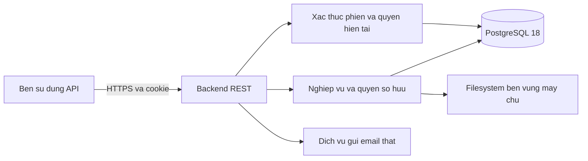

# Kiến trúc backend và ranh giới hệ thống

Lựa chọn ngày 17/11/2026 được CONFIRMED theo [sổ DEC](../decisions/open-decisions.md#evidence-2026-11-17); chi tiết chưa chọn còn DRAFT. Chưa có backend thực thi, xem [status](../project/status.md).

## Thành phần

Sơ đồ là kiến trúc đích, không phải các service/module đã có. Bộ docs không đặc tả màn hình hoặc triển khai frontend; cùng origin/cookie là ràng buộc tích hợp HTTP.

| Thành phần | Lựa chọn/trách nhiệm | Giới hạn |
| --- | --- | --- |
| HTTP backend | Node.js 24 LTS, Express 5, JavaScript ESM/npm | Zod/Multer/jose/scrypt/node-pg-migrate/node:test/fetch/ESLint đã chọn; versions/lệnh/config còn DEC-014 |
| Auth | JWT + auth_sessions PostgreSQL, cookie/CSRF, user/quyền DB | Cookie/header đã chọn, response/lifecycle/Origin còn DEC-017 |
| Email | OTP đăng ký/reset qua email thật | Resend HTTPS/fetch; timeout/lỗi/wire còn DEC-003 |
| Nghiệp vụ | Listener → hồ sơ Creator → upload/nghe/playlist/quản trị | UC và BR đã đồng bộ; hợp đồng bổ sung còn DEC-005 |
| Database | PostgreSQL 18, pg, SQL tham số hóa, migration phiên bản | Schema đích còn DEC-022; SQL hiện có chưa sửa/chạy |
| Media | Filesystem bền vững máy chủ; audio kiểm tra trạng thái/Range | GET/HEAD audio, single Range/no-store/cleanup đã chốt; chi tiết runtime/recovery state còn DEC-014/017/022 |

## Tổ chức mã đã có

backend/src/config, controllers, middlewares, routes và uploads hiện chỉ có .gitkeep; chưa có manifest hoặc process hoạt động. Không ép thêm layer hoặc microservice từ sơ đồ. Thiết kế cùng origin frontend/API, có HTTPS khi online; nhà cung cấp hosting/email chưa chọn. File audio local là local của máy chủ, không yêu cầu toàn bộ sản phẩm độc lập Internet.

## Luồng dữ liệu chính

**Đăng ký:** nhận thông tin Listener → gửi OTP email thật → xác minh → kích hoạt → login riêng. User mới email_verified_at NULL; Resend/digest HMAC/5 lần gửi-email-giờ đã chọn, timeout/đăng ký lại còn DEC-003/022.

**Xác thực/thay đổi:** cookie → kiểm tra chữ ký/claim, phiên và user DB → quyền hiện tại/sở hữu → cập nhật. Logout thu hồi riêng phiên; khóa/đổi mật khẩu thu hồi tất cả. Approve Creator có hiệu lực request tiếp theo. Phiên DB còn hạn qua restart; DB lỗi không cho qua xác thực.

**Đọc public:** kết hợp tracks/genres/users, chỉ trả track chưa gỡ và chủ không khóa; filter/search/pagination/sort đã chọn. Playlist loại track ẩn nhưng giữ liên kết; reorder ID hiển thị/ẩn cuối-hiện lại cuối/tập đổi 409, response/schema còn DEC-005/017/022.

**Upload:** quyền/CSRF → file tạm → ffprobe/FFmpeg/Sharp kiểm tra và duration ceiling → transaction kiểm tra lại → chuyển file chính → ghi track/commit → 201. UUID, temp/final cùng filesystem; commit không rõ phải đối chiếu trước dọn. Dọn startup/mỗi 30 phút theo điều kiện tuổi >24 giờ, tham chiếu và thao tác đang chạy; [media lifecycle](security-and-media.md#file-lifecycle) sở hữu chi tiết. Transaction DB không rollback filesystem.

**Nghe:** metadata audioUrl → API-28 GET/API-29 HEAD audio kiểm tra trạng thái, single Range và no-store → client listenedSeconds >=10/cooldown trượt 30 phút/đếm cùng transaction/lặp 200-counted:false. Guest UUID cookie ký/login chuyển user ID có thể thêm lượt/cooldown giữ bảy ngày; chưa chứng minh nghe thật. Chặn request audio mới sau gỡ/khóa; request đang chạy có thể hoàn tất.

**Creator:** nộp hồ sơ riêng → pending không sửa → approve/reject có lịch sử → role/status được cập nhật nguyên tử theo mô hình sẽ chốt. Không dùng user.created_at thay ngày nộp.

## Ranh giới đặc tả còn thiếu

Đọc [sổ DEC](../decisions/open-decisions.md) trước bootstrap. Đã chọn công cụ/auth/Resend/schema logic/search_text/cooldown/reorder tại ADR-0005. Response/field/CSRF lifecycle/conditional HTTP-ảnh/versions-limits-lệnh/schema vật lý-recovery/hosting-backup-lịch còn thiếu. Email provider đã chọn, chưa có tài khoản/key/domain xác minh. Chỉ ghi cấu hình cần có, chưa tự cài dịch vụ, tạo endpoint hoặc migration.

Các ADR: [auth](../decisions/adr-0001-authentication-and-sessions.md), [media/online](../decisions/adr-0002-media-and-online-readiness.md), [nền tảng](../decisions/adr-0003-backend-and-database.md), [audio/file lifecycle](../decisions/adr-0004-audio-contract-and-file-lifecycle.md). Chi tiết dữ liệu ở [data model](data-model.md), auth/media ở [security and media](security-and-media.md), wire ở [API](../api/README.md).

[ADR-0005](../decisions/adr-0005-simple-backend-contracts.md) bổ sung auth/nền tảng và thay reorder cũ; [xác nhận](../decisions/open-decisions.md#evidence-simple-2026-11-17).
