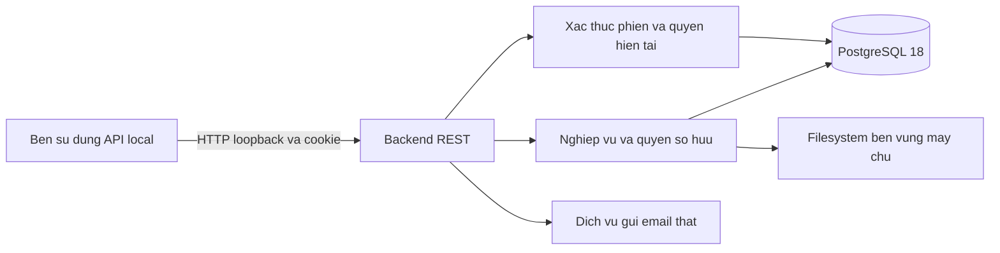

# Kiến trúc backend và ranh giới hệ thống

Lựa chọn kiến trúc được ghi tại [sổ DEC](../decisions/open-decisions.md). Chi tiết chưa chọn còn `DRAFT`. Bootstrap HTTP và migration chín bảng đã chạy trong môi trường thử. [Kết quả kiểm chứng](../project/status.md#single-database-migration-2026-11-20).

## Thành phần

Sơ đồ là kiến trúc đích. Bản hiện tại chạy local trên Windows/PowerShell. Bộ docs không đặc tả màn hình hoặc triển khai frontend; origin và cookie là ràng buộc tích hợp HTTP.

| Thành phần | Lựa chọn/trách nhiệm | Giới hạn |
| --- | --- | --- |
| HTTP backend | Node.js 24.22.3 LTS, Express 5, JavaScript ESM/npm | Bootstrap đã lắng nghe HTTP và kiểm tra kết nối DB khi khởi động. Dependency thực tế được khóa ở `backend/package-lock.json`. [Thiết lập](../development/local-setup.md). |
| Auth | JWT + auth_sessions PostgreSQL, cookie/CSRF, user/quyền DB | [API-39](../api/auth.md#api-39) có response và lỗi phiên. Cookie Domain, Origin và lỗi CSRF trên request ghi còn DEC-017. |
| Email | OTP đăng ký/reset qua email thật khi demo | Resend HTTPS/fetch, kiểm thử qua giả lập. [Vòng đời OTP](security-and-media.md#otp-delivery) dùng hạn mức email; DEC-022 ghi migration cho phép `request_ip` nhận `NULL`. |
| Nghiệp vụ | Listener → hồ sơ Creator → upload/nghe/playlist/quản trị | UC và BR đã đồng bộ; [DEC-005](../decisions/open-decisions.md#dec-005) chốt hợp đồng bổ sung cho Auth, Creator và playlist. |
| Database | PostgreSQL 18.7, pg, SQL tham số hóa, migration phiên bản | [Chín bảng nghiệp vụ](data-model.md#target-model) trong một migration khởi tạo. Giao dịch nhiều bảng và recovery còn DEC-022. |
| Media | Filesystem của máy chạy backend; audio kiểm tra trạng thái/Range | GET/HEAD audio, Range và cleanup đã chốt. [Công cụ và giới hạn local](security-and-media.md#upload-kiem-tra-file-va-duration) ở mức đặc tả. HTTP và recovery thuộc DEC-017/022. |

## Tổ chức mã đã có

[Entrypoint](../../backend/src/server.js) đọc cấu hình và khởi động [HTTP server](../../backend/src/app.js) với PostgreSQL. `controllers`, `middlewares`, `routes` và `uploads` vẫn là thư mục khung. Local mặc định bind loopback. Demo gửi OTP qua Resend. Audio nằm trên filesystem của máy chạy backend.

## Luồng dữ liệu chính

**Đăng ký:** nhận thông tin Listener → gửi OTP email thật → kiểm OTP và mật khẩu của lần đăng ký hiện tại → kích hoạt → login riêng. User mới có `email_verified_at` là `NULL`. [ADR-0008](../decisions/adr-0008-registration-otp.md).

**Xác thực/thay đổi:** cookie → kiểm tra chữ ký/claim, phiên và user DB → quyền hiện tại/sở hữu → cập nhật. Logout thu hồi riêng phiên; khóa/đổi mật khẩu thu hồi tất cả. Approve Creator có hiệu lực request tiếp theo. Phiên DB còn hạn qua restart; DB lỗi không cho qua xác thực.

**Đọc public:** kết hợp tracks/genres/users, chỉ trả track chưa gỡ và chủ không khóa; filter/search/pagination/sort đã chọn. Playlist loại track ẩn nhưng giữ liên kết. [API-38](../api/playlists.md#api-38) nhận và trả thứ tự ID hiển thị, tập đổi trả 409; thứ tự khóa còn DEC-022.

**Upload:** quyền/CSRF → file tạm → ffprobe/FFmpeg/Sharp kiểm tra và duration ceiling → transaction kiểm tra lại → chuyển file chính → ghi track/commit → 201. UUID, temp/final cùng filesystem; commit không rõ phải đối chiếu trước dọn. Dọn startup/mỗi 30 phút theo điều kiện tuổi >24 giờ, tham chiếu và thao tác đang chạy; [media lifecycle](security-and-media.md#file-lifecycle) sở hữu chi tiết. Transaction DB không rollback filesystem.

**Nghe:** metadata audioUrl → API-28 GET/API-29 HEAD audio kiểm tra trạng thái, single Range và no-store → client listenedSeconds >=10/cooldown trượt 30 phút/đếm cùng transaction/lặp 200-counted:false. Guest UUID cookie ký/login chuyển user ID có thể thêm lượt/cooldown giữ bảy ngày; chưa chứng minh nghe thật. Chặn request audio mới sau gỡ/khóa; request đang chạy có thể hoàn tất.

**Creator:** nộp hồ sơ riêng → pending không sửa → approve/reject có lịch sử → role/status được cập nhật nguyên tử theo mô hình sẽ chốt. Không dùng user.created_at thay ngày nộp.

## Ranh giới đặc tả còn thiếu

Phần còn mở gồm quy tắc HTTP ngoài phần đã chốt, migration cho phép `request_ip` nhận `NULL`, giao dịch nhiều bảng, recovery file, dữ liệu demo và điều kiện đo local. Online, backup/restore và hạn mức IP thuộc hướng mở rộng. [ADR-0010](../decisions/adr-0010-local-runtime-scope.md).

Các ADR: [auth](../decisions/adr-0001-authentication-and-sessions.md), [media/online](../decisions/adr-0002-media-and-online-readiness.md), [nền tảng](../decisions/adr-0003-backend-and-database.md), [audio/file lifecycle](../decisions/adr-0004-audio-contract-and-file-lifecycle.md). Chi tiết dữ liệu ở [data model](data-model.md), auth/media ở [security and media](security-and-media.md), wire ở [API](../api/README.md).

[ADR-0005](../decisions/adr-0005-simple-backend-contracts.md) bổ sung auth/nền tảng và thay reorder cũ; [xác nhận](../decisions/open-decisions.md#evidence-simple-2026-11-17).
