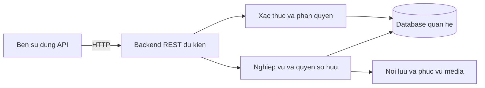

# Kiến trúc backend và ranh giới hệ thống

Trạng thái thiết kế: `DRAFT`. Chưa có backend thực thi trong checkout; xem [status](../project/status.md).

## Thành phần

Sơ đồ diễn đạt trách nhiệm dự kiến, không khẳng định đã có module/service tương ứng. Bên sử dụng API nằm ngoài phạm vi thiết kế triển khai của bộ docs.

| Thành phần | Trách nhiệm dự kiến | Hiện trạng/ràng buộc |
| --- | --- | --- |
| HTTP backend | Nhận request, xác thực, kiểm tra dữ liệu, trả kết quả và lỗi | Định hướng Node.js/Express; toolchain còn DEC-014 |
| Auth/quyền | Xác minh người dùng, role hiện tại và quyền sở hữu | JWT/Bcrypt được mô tả; vòng đời phiên còn DEC-006 |
| Nghiệp vụ | Tài khoản, track, thể loại, playlist, review và moderation | Danh mục UC và API còn DRAFT |
| Database | Lưu metadata và quan hệ | SQL PostgreSQL hiện có; hệ quản trị đích còn DEC-013 |
| Media | Nhận file, lưu, đọc và thực thi chính sách truy cập | Local/cloud và giao thức phục vụ còn DEC-008/DEC-009 |

## Tổ chức mã đã có

`backend/src/config`, `controllers`, `middlewares`, `routes` hiện là thư mục có `.gitkeep`. Có khung `backend/uploads/audio` và `images`. Đây là quan sát cấu trúc, không yêu cầu phải thêm service/repository layer hoặc tách microservice. Thiết kế mô tả monolith/single-host, chưa có cấu hình process/port hoạt động.

## Luồng dữ liệu chính

**Đọc kho nội dung:** request public → kiểm tra query theo hợp đồng → đọc `tracks` cùng `genres/users` cần thiết → áp dụng quy tắc hiển thị → trả metadata. Tìm kiếm, pagination và thứ tự xem [API](../api/README.md) cùng DEC-012/DEC-017/DEC-018.

**Thay đổi tài nguyên:** request có phiên → xác thực và quyền sở hữu/role → kiểm tra trạng thái tài nguyên → thay đổi dữ liệu → trả kết quả. Token có role cũ không tự chứng minh quyền hiện tại; cách kiểm tra còn DEC-006.

**Upload:** request có quyền → kiểm tra file và metadata → phối hợp ghi media và track → trả dữ liệu. File system và database có thể thất bại độc lập; xử lý dở dang còn DEC-009. Không tự giả định transaction DB rollback được file.

**Nghe audio:** đọc chi tiết track → nhận tham chiếu media → truy cập file theo hợp đồng sẽ chốt; sự kiện lượt nghe là luồng riêng. Ẩn track khỏi API không tự thu hồi đường dẫn file đã biết.

**Creator:** tiếp nhận thông tin theo luồng còn mở → pending → Admin approve/reject → cập nhật status/role → quyền mới có hiệu lực theo cơ chế phiên được chốt. Mô hình hồ sơ còn DEC-002/DEC-005/DEC-007.

## Các ranh giới cần xác nhận

[DEC-013](../decisions/open-decisions.md#dec-013) và [DEC-014](../decisions/open-decisions.md#dec-014) chặn việc chọn dependency, kết nối và migration. [DEC-008](../decisions/open-decisions.md#dec-008)/[DEC-009](../decisions/open-decisions.md#dec-009) chặn thiết kế media. Không tự tạo cấu hình deploy, cloud service, bảng bổ sung hoặc endpoint để lấp các khoảng trống.

Thiết kế dữ liệu chi tiết nằm tại [data model](data-model.md); cơ chế auth/media ở [security and media](security-and-media.md); wire contract thuộc từng [nhóm API](../api/README.md).
